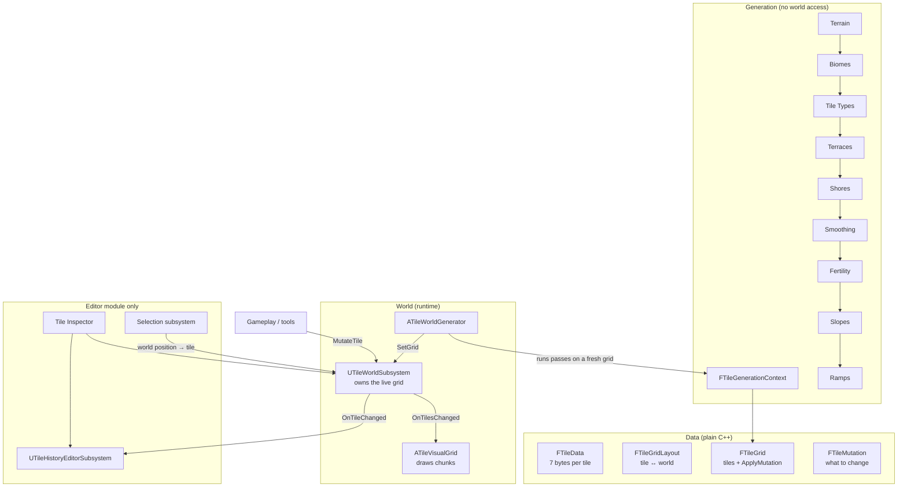

# ChillFarmGame: world architecture

This document describes the tile world foundation after the `claude/world-foundation-architecture` changes: what the game needs from it, how it is built, why each decision was made, what changed compared to `TerrainGenerationMVP`, and what comes next.

> **Status:** written and reviewed without an Unreal toolchain. The pure logic was compiled and tested outside the engine with stubbed types, but the Unreal code has **not been compiled yet**. Section 7 is the checklist to run first.

---

## 1. What the game asks of the world

The architecture is judged against the game, not against general good practice. These are the goals as stated for the project:

| Game goal | What it requires from the world code |
|---|---|
| Cozy farming, "Stardew Valley in 3D" | Tiles are the unit of gameplay: every system (planting, building, walking) talks in tile coordinates. |
| Varied terrain, not flat, no caves | Discrete elevation levels per tile (terraces), joined by slopes in some places and cliffs in others, ramps where a terrace would be cut off. Farm tiles stay flat. |
| Procedural world, player picks the farm site | Generation must produce meaningful differences between places (fertility, water, slope, distance to road) and be deterministic from a seed. |
| Player edits tiles (till, water, build) | One safe way to change a tile at runtime, and a way for visuals and other systems to react. |
| Learning project, done properly | Clear layers, testable logic, tools that explain the world (Tile Inspector). |
| Automated tests planned | Logic that runs without a level or a running game. |

---

## 2. Layers

The rule that holds everything together: **dependencies only point down or sideways through events.** Data knows nothing about generation, generation knows nothing about the world, the world knows nothing about the editor. Whoever changes a tile does not call the systems that care; those systems subscribe.

### 2.1 Data: `FTileData`, `FTileGridLayout`, `FTileGrid`, `FTileMutation`

- `FTileData` holds only values that cannot be derived from anything else: `Type`, `Biome`, `Height` (level), `Fertility`, `Moisture`, `Flags`. Six bytes, copyable, comparable, hashable. A 512×512 map is 1.5 MB.
- `FTileGridLayout` is the only place that converts between tile coordinates and world positions. Tile `(X, Y)` covers `[X, X+1) × [Y, Y+1)` tiles from `Origin`; its top surface is at `Origin.Z + Height * LevelHeight`.
- `FTileGrid` is a plain C++ class: layout plus tiles. Reads are const; `ApplyMutation` is the only write.
- `FTileMutation` says which fields to set. Its setters, its apply code, the field diff and the field names are all generated from one macro list (`CFG_FOREACH_TILE_VALUE_FIELD`), and a `static_assert` on `sizeof(FTileData)` fails when someone adds a field without updating that list.

### 2.2 World: `UTileWorldSubsystem`

One per world (editor, PIE, game). Owns the live grid.

- `SetGrid(FTileGrid&&)` takes a generated map, `ClearWorld()` drops it.
- `MutateTile(Tile, Mutation, Context)` is the runtime edit path for gameplay and tools. It applies the change and broadcasts `OnTileChanged` (full before/after/context) and `OnTilesChanged` (coordinates, for visuals).
- `NotifyExternalChange` lets generation report changes on a grid the subsystem does not own yet, so the editor can record generation history without generation knowing the editor exists.
- `FindTileAt(WorldLocation)` answers "which tile is here" for gameplay and tools.

### 2.3 Generation: passes

`ATileWorldGenerator::GenerateWorld` builds a fresh `FTileGrid`, runs its passes on it through an `FTileGenerationContext`, then hands the grid to the subsystem and asks the visual grid to draw it.

| Pass | Reads | Writes |
|---|---|---|
| Terrain | seed | height/moisture/detail noise fields; water tiles; height levels |
| Biomes | noise fields, biome set | biome, moisture |
| Tile Types | biome rule sets | tile type |
| Terraces | height levels | height levels (no neighbours more than one level apart) |
| Shores | tile types, biome set | shore tile type next to water |
| Smoothing | tile types, biome set | replaces isolated land tiles |
| Fertility | final tile types, moisture, biome set | fertility = biome base × soil factor of the tile type × moisture factor |
| Slopes | height levels, slope noise | raised corners on low tiles next to higher land where the noise is soft: runs of slope with edge and corner pieces, cliffs elsewhere (see D14) |
| Ramps | height levels, slopes | an edge slope on a flat low tile wherever a terrace would otherwise be cut off (see D13) |

Passes are `EditInlineNew`/`Instanced` objects, so each generator on a level has its own editable copies, and a new step is a new subclass. Passes only see the context: no world, no actors. Each pass gets its own random stream derived from seed + salt, so adding a pass does not reshuffle the others.

### 2.4 Visuals: `ATileVisualGrid`

Draws the subsystem's grid with one HISM component per autotile piece per chunk.

- Holds no tile data. Rebuilds everything on `RebuildAll`, and only the affected chunks (plus neighbours, because pieces depend on neighbours) on `OnTilesChanged`.
- Places each mesh so the centre of its bounds sits on the tile centre and its top is flush with the tile level, whatever the mesh pivot is.
- Components are transient. The level saves the seed and settings, not 16 000 instances; the editor module regenerates the map when a level opens.

### 2.5 Editor tools

- `UTileHistoryEditorSubsystem` (editor worlds only) records every `FTileChange`. The runtime contains no history code.
- `UTileDebugSelectionEditorSubsystem` maps a click on the tile map to a tile through the layout (`ImpactPoint` pushed slightly into the surface), and draws the highlight box from the layout.
- `STileInspectorWindow` shows the tile's current data and its history: one header per change (`#3  WorldGeneration / Shores: Next to water`) and one line per changed field (`Type: Grass -> Sand`). It polls a version number, which survives map changes without delegate bookkeeping.

### 2.6 Tests

Automation specs live in `Source/ChillFarmGame/Tests`, grouped under `ChillFarmGame.TileWorld`:

| Spec | Covers |
|---|---|
| `Data` | `FTileData` diff and field names, `FTileMutation` (only set fields, real changes only, flags), `FTileGridLayout` (index and world round trips, tile edges, negative positions, levels, bounds), `FTileGrid` |
| `Algorithms` | Terrace clamping (checked against a brute-force reference on random fields, never raises, idempotent), autotile resolver (every piece and rotation, map edges) |
| `BiomesAndRules` | Biome selection and blending, `FindBiome`, rule order and noise sources |
| `Generation` | Generation context, `TileGeneration::RunPasses` (order, disabled passes, all-or-nothing setup check), each pass on hand-made grids, and the full pipeline: determinism, world invariants (no steep steps, shores are sand, water on level 0...), and replaying the recorded history rebuilds the exact final world |
| `Subsystem` | `UTileWorldSubsystem` events, runtime edits, position lookup |
| `Cliffs` | Which edges get a side (raised tiles, deeper drops, map edges, chunk ranges, slopes), wall and slope piece placement for any mesh pivot |
| `Farming` | Tilling and watering rules (no farmland on slopes), the use action, a gameplay change reaching listeners with its step |
| `Reachability` | Which neighbours can be stepped between (corner heights, slopes, water), walkable areas and land islands |

Grids in tests are written as rows of characters (`G` grass, `W` water...) with `TileTestUtils::MakeGrid`, so the expected map is readable in the test itself. Equality checks use `TileTestUtils::TestEq`, which prints both values on failure and does not depend on engine-version-specific `TestEqual` overloads.

The specs were run outside the engine against stand-in types (88 passing), and checked with mutation testing: 18 deliberate bugs, including every bug fixed in commit 1, were reintroduced one at a time and each made at least one spec fail.

The pass runner is a free function (`TileGeneration::RunPasses`) rather than a generator method, so tests and a future background generation can run passes without an actor.

---

## 3. Commit 1: targeted fixes

These fixes stand on their own; the refactor in commit 2 keeps them.

| # | Problem | Visible effect | Fix |
|---|---|---|---|
| 1 | `FTileMutationHelper::Apply` wrote the wrong field in four of seven branches | Moisture, neighbour mask, smoothing override and occupancy were never applied; fertility got overwritten with 255 | Each branch writes its own field |
| 2 | `RecalculateNeighbors` wrote the stored mask back to itself | Every tile had mask 0 and rendered as Isolated | Writes the computed mask; runs after the post process |
| 3 | `FTileNeighborResolver` tested single missing sides before pairs | Corner and InnerCorner were never produced | Decides by number of matching sides; all 256 masks checked |
| 4 | Biome scoring treated range centres as worse than edges; blend weight was ≥ 0.5 and compared against a 0–0.25 value | The second-best biome won almost everywhere | Distance is 0 inside a range; blend weight 0–0.5 compared against 0–1 noise |
| 5 | `FinalizeNavigation` existed but nothing called it | NavMesh not rebuilt for generated tiles | Called after generation; HISM cluster tree built synchronously first |
| 6 | `GetHistory` dereferenced a null `Find()` | Editor crash when clicking a tile with no history | Returns a static empty array |
| 7 | History entries had no coordinates and were never cleared | Snapshot registry keyed everything as (0,0); regenerations piled up | Coordinates filled; cleared on regeneration |
| 8 | `#include "Editor.h"` in the runtime module | Non-editor (game) builds fail | Removed |
| 9 | "Missing TileType" checks in data asset constructors | Warnings for every type on every load, regardless of asset content (constructors run before data is loaded) | Moved to `IsDataValid` |
| 10 | Viewport click: unchecked `static_cast` of the viewport client, only a rectangle test | Click on a docked tab over the viewport selected a tile | Client looked up safely; Slate's widget path under the cursor must contain the viewport widget |
| 11 | `IMPLEMENT_MODULE` in the editor module header | Duplicate symbols as soon as a second file includes it | Moved to the .cpp |
| 12 | Null/asset failures in generation and visuals | Crashes on a level that is not fully set up | Readable errors and fallbacks |

---

## 4. Commit 2: decisions and their analysis

Each entry: what it was, what it is now, why, and what it costs.

### D1. Tile data became plain values

- **Before:** `FTileData` held a `UBiomeTypeData*`, a cached neighbour mask, a smoothing override, coordinates and an occupancy bool.
- **After:** six bytes of values. Biome is `EBiomeType`; the mask is computed by the visual layer; coordinates are the array index; occupancy is a flag bit.
- **Why:** the cached mask and override were exactly the fields that went stale or were never set (bugs 1, 2, 5). A UObject pointer per tile ties tile data to the garbage collector and to asset loading, which blocks background generation and makes saving harder. Plain values can be copied into a save, compared in a test and processed on any thread.
- **Cost:** biome lookups go through `UBiomeTypeDataSet::FindBiome` (a linear search over five entries). Two biome assets with the same type would be ambiguous; `IsDataValid` on the set reports that.

### D2. One layout for all tile ↔ world math

- **Before:** `UTileDataGrid::WorldToTile`, the visual grid's chunk origin and the inspector's instance lookup each had their own convention, and visuals placed tiles at the corner while the data grid used the centre.
- **After:** `FTileGridLayout`, used by generation, visuals, selection and gameplay.
- **Why:** "which tile is under this point" needs exactly one answer once gameplay depends on it (click to till, walk to tile, place a building).
- **Cost:** the drawn world moves by half a tile compared to before (tiles now sit on their centres). Nothing in the test map depends on exact positions.

### D3. Mutations generated from one field list

- **Before:** a macro generated setters, but `Apply` and `HasAnyChange` were written by hand, which is how bug 1 happened.
- **After:** setters, apply, diff and field names all come from `CFG_FOREACH_TILE_VALUE_FIELD`. `ApplyTo` returns the fields whose value actually changed, so setting a value to itself is not recorded as a change.
- **Cost:** macros are harder to step through in a debugger. The list is short and the generated code is trivial, so this is a good trade here.

### D4. `UTileWorldSubsystem` owns the live map

- **Before:** the grid was a subobject of the generator actor, and the generator called the visual grid and the history directly.
- **After:** a world subsystem owns the grid and broadcasts changes; visuals and history subscribe.
- **Why:** gameplay will change tiles from many places (player controller, tools, crops, weather). If each caller had to remember to update visuals, navigation, history and saves, one would eventually forget. With events, a new system just subscribes.
- **Cost:** control flow is less explicit: to see what happens after a change you look for subscribers, not at the call site.

### D5. History moved to the editor module

- **Before:** `UTileMutationHistorySubsystem` lived in the runtime module (guarded by `IsEditorWorld`), and included `Editor.h`.
- **After:** the runtime broadcasts changes; `UTileHistoryEditorSubsystem` in the editor module records them. During generation the change is only built when somebody listens.
- **Why:** this answers "how do I keep editor code out of gameplay code without `#if` everywhere": the runtime exposes an event, the editor subscribes. The game build contains no history code and pays nothing for it.
- **Cost:** history exists only in editor worlds (not in PIE). That matches the use: the inspector is an edit-time tool.

### D6. Generation as a list of passes

- **Before:** one generator function plus a post-processor class with fixed steps.
- **After:** instanced pass objects run in order on an `FTileGenerationContext`.
- **Why:** the planned features are all new passes: ramps, rivers, roads, resources, farm site scoring, site validation. Each pass is small, has its own settings, can be disabled to see its effect, and can be tested alone.
- **Cost:** noise settings moved from the generator to the Terrain pass. The test map never changed them, so nothing is lost there; if another level did, re-enter the values on its Terrain pass.

### D7. Generation does not touch the world

- **Why:** determinism (same seed, same map, tested), tests without a level, and later background generation for larger maps. Only the generator actor bridges between the pure pipeline and the world.
- **Cost:** passes cannot query the level (for example, hand-placed landmarks). When that is needed, pass the data in through the context.

### D8. Elevation levels and the Terraces pass

- **Before:** no elevation.
- **After:** `Height` level per tile from the height noise (`MaxLevel`, default 0, so the world stays flat until you enable it), and a pass that cuts slopes so direct neighbours differ by at most one level. The algorithm is a two-sweep clamp, O(tiles), checked against brute force on 300 random grids.
- **Why:** Stardew-style terrain is discrete terraces with cliffs, not smooth hills; farm tiles must be flat.
- **Cost:** with `MaxLevel > 0` tiles are drawn at their height; the sides are drawn by D12. The PlayerStart is placed by hand, so the game mode stands the pawn in the middle of the tile under it, on that tile's level.

### D9. Smoothing does something now

- **Before:** acted only on a `SmoothingOverride` that nothing set.
- **After:** isolated land tiles (at most one same-type direct neighbour) take the biome's `SmoothingOverrides` entry, or the most common neighbour type. Water and shore tiles are left alone.
- **Cost:** generated maps look different from before (fewer single-tile specks). Disable the pass to compare.

### D10. Visuals redraw by chunk and do not depend on mesh pivots

- **Before:** full regeneration only; instances placed by corner; tile lookup through a hand-maintained `InstanceToTile` map that was never cleared or saved.
- **After:** chunk rebuilds on change (with neighbours), placement from mesh bounds, selection through the layout. `InstanceToTile` is gone, together with its stale-pointer and "(0,0) after reopening the map" problems.
- **Cost:** rebuilding a whole chunk for one changed tile is more work than updating one instance. At 64×64 tiles per chunk it is a few milliseconds and happens on a click, not every frame. If it ever shows up in a profile, lower `ChunkSize` or update instances in place.

### D11. The map is regenerated, not saved

- **Why:** a 128×128 map takes milliseconds to generate; saving 16 000 HISM instances in the level made it heavy and fragile (and `InstanceToTile` was not saved with them). Seed + settings is the source of truth.
- **Cost:** editor load runs generation once. Turn off `bGenerateWhenLevelOpens` on a generator to skip it.

### D12. Cliffs are stretched walls, derived from heights

- **Before:** terraces were floating plates.
- **After:** `TileCliffs` finds every edge where a tile is higher than its neighbour (the map edge counts as level 0) and the visual grid draws one wall per edge with `CliffMesh` from the visual set, stretched from the mesh bounds into the drop. One instanced component per chunk. A wall belongs to the high tile and sits just inside its edge, so it is rebuilt with that tile. The autotile mask treats a same-type neighbour on another level as different, so surfaces get edges along cliffs.
- **Why:** smallest step that makes elevation readable and blocks walking up a level, with no new art: any mesh works, a cube is fine. Visual only, so it can never disagree with the data.
- **Cost:** a tall drop stretches one wall, so a textured cliff material would stretch too. Corners are plain overlaps, not shaped pieces. The dual-grid evaluation (roadmap step 1) still decides the final look; this version can be replaced inside `ATileVisualGrid` without touching data or passes.

### D13. Ramps are a tile field, placed until every island can be walked

- **Before:** terraces were cut off from each other by cliffs; nothing guaranteed the player could reach them.
- **After:** a ramp is an edge slope (see D14): the two corners of the tile's edge towards the higher terrace are raised. `TileReachability` defines walking from the data alone (D14). The Ramps pass (last in the pipeline) labels the walkable areas, starts from the largest area of every land island and keeps placing a ramp (on a flat low tile with ground on its own level behind it, rising into a terrace whose edge is exactly one level up) between a reached and an unreached area, picking among valid places with the seed. After the Slopes pass it only has to cut into the cliffs that are left. Farmland cannot be made on a slope.
- **Why:** a ramp is terrain, like height, so it lives in the tile data, is recorded in the history and is visible in the Inspector. Reachability is checked on data, so it is tested without navmesh or physics.
- **Cost:** a slope rises one level over one tile. With the test map's 100-unit tiles and levels that is 45°, so the character's walkable floor angle and the navmesh's `AgentMaxSlope` are raised to 50°, and the navmesh step height to 45 (Recast warns, and leaves holes on steep slopes, when the step is too low for the slope). Gentler slopes over two tiles would need more data per tile. Islands that only water separates stay apart until bridges exist.

### D14. Slopes are raised tile corners, mixed with cliffs by noise

- **Before:** every change of level was a cliff, broken only by single ramp tiles (D13, first version).
- **After:** `FTileData::Slope` (replacing `Ramp`, still seven bytes per tile) is a bitmask of `ETileCorner`: the corners that are one level above the tile's `Height`. Two corners of one edge make an edge slope, one corner an outer corner, three corners an inner corner (`TileData::GetSlopeShape`); opposite corners are never generated. The Slopes pass raises a corner of a low tile when a tile around that corner is land one level higher and a Perlin noise sampled at the corner is below `SlopeAmount`. All tiles around a corner read the same noise, so their surfaces agree at that corner. Tiles that would get opposite or all four corners (one-tile valleys) stay flat.
  - Walking (`TileReachability::CanStep`): two neighbours connect when their surfaces meet at the same height at one or both ends of the edge they share. Flat tiles on one level always meet; a slope meets the ground it rises to; flat tiles a level apart do not. One end is enough on purpose: beside the foot of a ramp, or where a slope runs out into a cliff, the drop next to the shared corner is lower than a step.
  - Cliffs (`TileCliffs::CollectFaces`): on every edge the side reaches from the lower of the tile's two corners down to the lower of the neighbour's. Where a slope runs out into a cliff, the higher ground's side reaches to the slope's low corner and its lower part is hidden inside the slope. A slope above lower flat ground draws no side: slope pieces must be solid and close their own sides.
  - Drawing: the visual set has a mesh slot per shape (`SlopeEdgeMesh`, `SlopeOuterCornerMesh`, `SlopeInnerCornerMesh`) and which way each faces in its own space. Pieces are stretched to one tile by one level and turned with `TileCliffs::MakeSlopePieceTransform`, in the tile type's material. Fallbacks while slots are empty: an edge tilts the tile mesh (sides stay open), an inner corner is drawn as two edge pieces (solid, no gaps), an outer corner is drawn flat on its level.
- **Why:** terraces read as hills in some places and as walls in others, and much more of the land can be walked without detours. Working on corners (marching squares) gives straight runs, inside and outside corners from one rule, and keeps the surfaces of neighbours consistent by construction.
- **Cost:** the test project has only the edge piece (`SM_Ramp`). Until corner meshes exist, diagonal runs of slope look like a sawtooth (flat outer corners between wedges). Corner meshes must be solid and fit a 1 × 1 × 1 box: the outer corner is a tetrahedron whose base is the half of the square on the raised corner's side (cut along the diagonal between the two neighbouring corners) and whose tip is one level above the raised corner; the inner corner is the full box with the top corner above the low corner cut off, by the plane through the two neighbouring top corners and the low corner's bottom.

---

## 5. What I deliberately did not change

- **Rendering technology.** HISM stays. Whether to move to one generated mesh per chunk depends on cliffs and map size, which are not decided yet. The visual grid is the only class that would change.
- **Data assets.** Property names that existing assets or the test map use were kept (`WorldSeed`, `GridSizeX/Y`, `GridTileSize`, `BiomeDataSet`, `DefaultTileGenerationRuleSet`, `TilesVisualSet`). Unused biome properties are kept under an "Unused" category so asset values survive.
- **Gameplay classes.** Player controller, character, crops and game mode keep their behaviour; the game mode still waits for `OnTerrainGenerated` before spawning the player.

---

## 6. Migration notes

When you open the project after these commits:

1. **Compile.** Expect a handful of compile errors at most; see section 7.
2. **First map open:** the log may warn that class `TileDataGrid` or `TileWorldPostProcessor` cannot be found. Those were subobjects of the old generator saved in the level. Save the map once and the warnings go away.
3. **Generator details panel:** noise settings are now under Passes → Terrain. Water level is there too.
4. **Asset warnings:** run Validate Assets on `Content/ChillFarmGame/GenerationTest`. The new validation reports real problems (empty rule sets, impossible noise ranges, missing tile visuals, duplicate biome types). The "saved with empty engine version" warnings are separate: re-save those assets in 5.7.
5. **Elevation:** set Terrain → Max Level to 3 or 4 to see terraces in the inspector (Height level) and in the viewport.

---

## 7. Verification checklist

Nothing below was possible without an Unreal toolchain.

1. Build `ChillFarmGameEditor` (Development Editor). Fix anything the compiler finds; the most likely spots are engine API signatures in `TileVisualGrid.cpp`, `ViewportMouseClickNotifier.cpp` and `STileInspectorWindow.cpp`.
2. Session Frontend → Automation → run `ChillFarmGame.TileWorld` (143 specs, see section 2.6).
3. Open the test map: the world appears without pressing Generate.
4. Click a tile: yellow box on that tile, inspector shows type/biome/fertility/moisture and readable history.
5. Click inside the Tile Inspector tab while it overlaps the viewport: nothing gets selected.
6. Play in editor: the character spawns and click-to-move works across the map (NavMesh covers the tiles; press `P` in the viewport to see it).
7. Validate Assets on the generation data.

---

## 8. Roadmap

Ordered so each step is visible and testable on its own, and nothing already working is thrown away.

1. **Cliffs and slopes.** First versions done (D12, D14): stretched walls per edge, corner-based slopes mixed in by noise. Missing: outer and inner corner meshes (D14 says what they must look like). Still to evaluate for the final look: Evaluate the dual grid: the visual grid is offset by half a tile and each visual tile reads its four corners (marching squares), which needs about six shapes instead of the current 8-neighbour piece set and handles both surface transitions and cliffs. The neighbour mask must also treat a same-type neighbour at another level as different.
2. **Ramps and reachability.** Done (D13, D14): slopes join much of the land, and the Ramps pass joins every remaining terrace to the rest of its island. Once roads exist, start the flood fill from the road instead of the largest area.
3. **Water.** Rivers carved downhill as a pass; water level per lake instead of a global threshold.
4. **Roads and farm sites.** A* road pass over a cost field (slope, water, biome). Derived per-tile fields with breadth-first distance transforms: distance to water, to road, size of the flat area. A scoring pass that rates farm sites and a validation pass that guarantees enough good ones. The inspector overlay for these fields is the prototype of the player's site selection screen.
5. **Gameplay edits.** Tilling and watering are in (`TileFarming`, right mouse, `ETileType::Farmland`, `ETileFlags::Watered`); building is next. All through `UTileWorldSubsystem::MutateTile` with `ETileMutationSource::Gameplay`. Keep crops, buildings and items out of `FTileData`: they are sparse objects keyed by tile coordinate in their own systems, which listen to tile changes.
6. **Saving.** Seed + generation settings + the list of gameplay changes (or a diff of the grid against a fresh generation). Small, and old saves keep working when unrelated generation code changes only if generation stays deterministic, which the determinism test guards.
7. **Scale.** Larger maps: run passes on a worker thread (they already have no world access), then chunk streaming for visuals.
8. **Rendering decision.** Revisit HISM vs. generated chunk meshes once cliffs exist and the target map size is known.

---

## 9. Open questions

- Target map size? It decides when background generation and streaming become necessary.
- Cliffs from modular art (the Fab environment pack, if it has rock pieces) or generated geometry?
- Should the player's farm site be flattened to one level when chosen, or must the generator guarantee flat areas?
- Does water ever change at runtime (irrigation, digging ponds)? That affects whether water stays a tile type or becomes its own layer.
